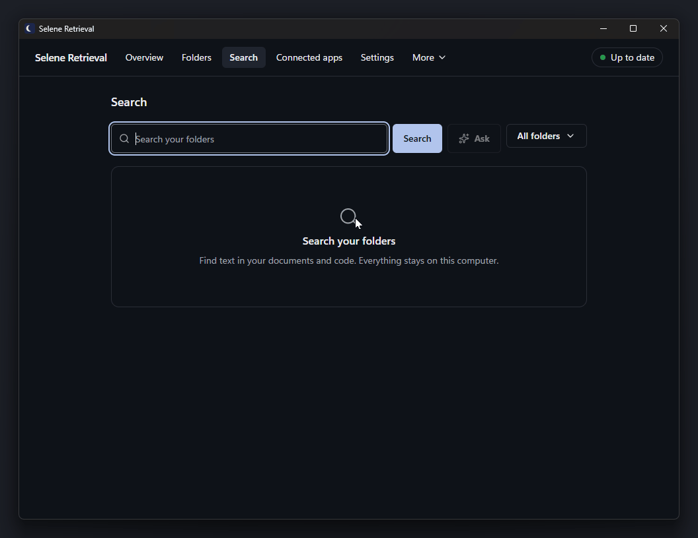
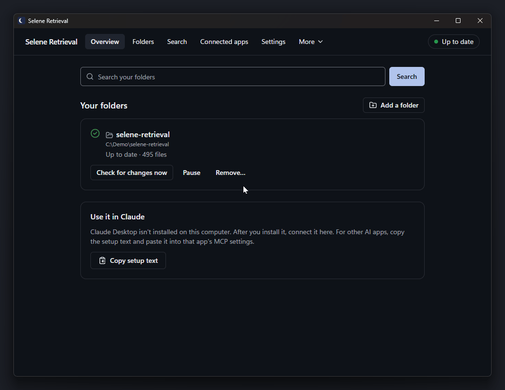
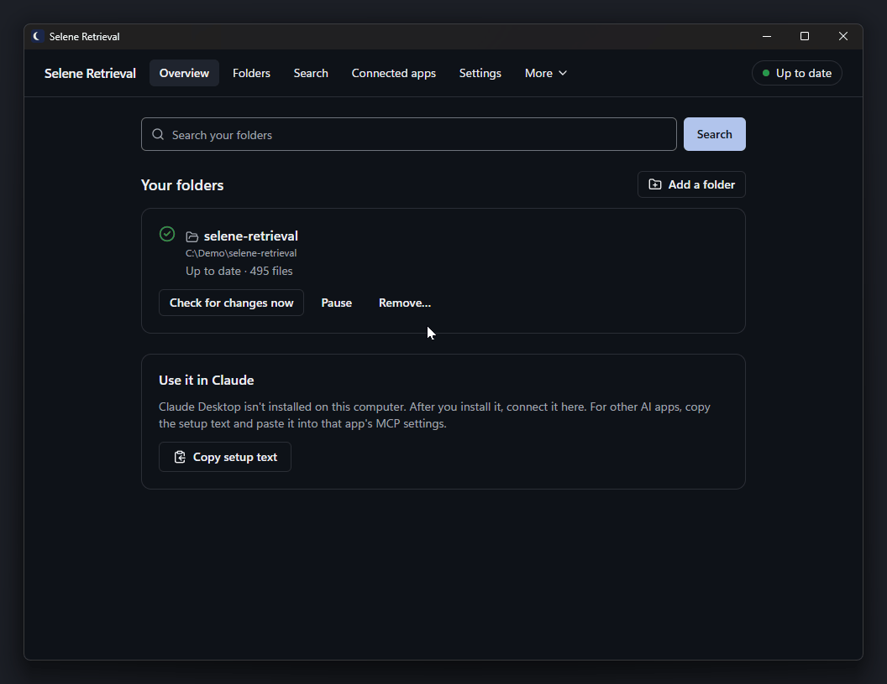
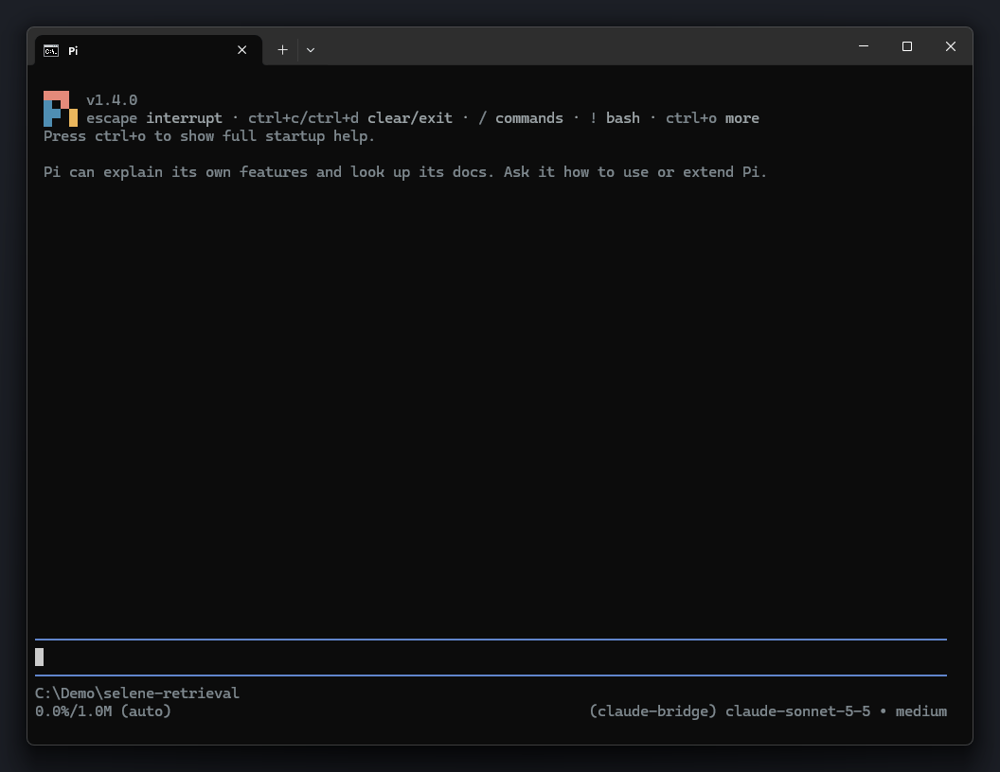

# Selene Retrieval

Let your AI apps search your own files. Private, local, free.

Selene Retrieval is a Windows desktop app and MCP server. It indexes folders on your PC and lets Claude Desktop, Cursor, VS Code and other MCP apps search them. Indexing and search run on your PC, and Selene Retrieval itself sends nothing online unless you turn on an online feature. The passages it gives your AI app are handled by that app, which may send them to its own AI service (see [Privacy and security](#privacy-and-security)).

[](LICENSE)
[](#install)
[](https://modelcontextprotocol.io)

**Status: beta.** Download the installer from the [Releases page](https://github.com/tercumantanumut/selene-retrieval/releases). It is not code-signed yet (see [Install](#install)). To build from source, see [CONTRIBUTING.md](CONTRIBUTING.md).

## See it in action

These clips search a copy of this repository. Some waits are shortened.

**Search, then Ask.** Search finds matching passages on your PC. **Ask** writes a short answer with numbered sources.



**Prompt Enhancer.** Write a rough prompt and press **Improve prompt**. The app adds useful context from your folders.



**Activity.** See what happened recently, and what was sent to an AI provider: when, what, how big and which app asked.



**An AI app using Selene Retrieval.** The [Pi](https://github.com/earendil-works/pi) coding agent calls `context_search`, then `context_answer`, and answers from your files.



## What it does

- Finds passages by meaning and by exact words (hybrid search: a vector index plus keyword search).
- Reads text, Markdown, code, HTML, PDF, and Word, Excel and PowerPoint files (`.docx`, `.xlsx`, `.pptx`).
- Keeps the index up to date: by default, new, changed and deleted files are picked up on their own while you work. You can also press **Check for changes now** on a folder in the app.
- Works with no account and no API key. A small embedding model is bundled, and your graphics card is used when it can help.
- Once you add an AI provider, writes short answers from your files with numbered citations, and the app's **Prompt Enhancer** page improves rough prompts. Both are off until then.

## Install

1. Download the setup file (`SeleneRetrieval-<version>-x64-setup.exe`) from the Releases page.
2. Run it. It installs for your Windows user only and asks for no admin rights. If Microsoft Edge WebView2 is missing, the installer runs Microsoft's small WebView2 setup, which needs the internet.
3. The first-run wizard opens:
   1. **Choose a folder to search.** The app may also offer to create one for you in Documents. Indexing starts at once and continues in the background.
   2. **Get written answers (optional):** add an AI provider (with its key or sign-in), or press **Skip for now**. Search works without one.
   3. **Use your folders in Claude:** press **Connect Claude Desktop**, choose whether the app starts with Windows, then press **Finish**.

**Windows SmartScreen.** The beta is not code-signed, so Windows may show "Windows protected your PC". Click **More info**, then **Run anyway**. PCs managed by an organisation may block unsigned apps completely.

**Check the download (optional).** Releases will include `SHA256SUMS.txt`, the checksum file the build writes next to the installer. In PowerShell, in your Downloads folder:

```powershell
(Get-FileHash .\SeleneRetrieval-0.1.0-x64-setup.exe -Algorithm SHA256).Hash
Select-String -Path .\SHA256SUMS.txt -Pattern "SeleneRetrieval-0.1.0-x64-setup.exe"
```

The two hashes must match. Letter case does not matter.

## Connect your AI app

Open Selene Retrieval and go to **Connected apps**. Press **Connect** next to your app. Then quit the AI app completely and open it again.

| App | One-click connect | Settings file that Connect changes |
|---|---|---|
| Claude Desktop (classic and Microsoft Store) | Yes | `claude_desktop_config.json` |
| Cursor | Yes | `%USERPROFILE%\.cursor\mcp.json` |
| VS Code and VS Code Insiders | Yes | `%APPDATA%\Code\User\mcp.json` (Insiders: `Code - Insiders`) |
| Any other MCP app | Copy the setup text from the **Other app** card | Your app's MCP settings |

Connect changes only the `selene-retrieval` entry. Other servers in the file are kept, and a backup of the old file is saved next to it. If the file can't be read (for example a VS Code `mcp.json` with comments), nothing is changed and you get the setup text to paste instead.

<details>
<summary>Setup text for other apps (stdio)</summary>

The **Other app** card shows text like this, with the real path of `sr-bridge.exe` on your PC. Copy it from the app rather than from here.

```json
{
  "mcpServers": {
    "selene-retrieval": {
      "command": "C:\\Users\\<you>\\AppData\\Local\\Selene Retrieval\\sr-bridge.exe",
      "args": ["--client", "other"]
    }
  }
}
```

</details>

<details>
<summary>Apps that need an HTTP address</summary>

Some tools connect over HTTP instead of starting a program. This is off by default.

1. In **Connected apps**, open **Advanced** and turn on **Allow other local tools to connect over HTTP**.
2. The address appears, for example `http://127.0.0.1:<port>/mcp`. It works only on this PC.
3. Press **Add a tool…**, give it a name and press **Create**.
4. Copy the setup text. It includes a password for this tool (sent as `Authorization: Bearer <password>`). Keep it private.

To cut a tool off, press **Revoke…** next to it.

</details>

**Disconnect.** Press **Disconnect** on the app's card, then restart the AI app. Uninstalling Selene Retrieval also removes its entries from these apps.

## Try it

Ask your AI app, for example:

- "Search my documents for the lease agreement."
- "Which of my notes mention the project budget? List the files."
- "Find where `parseConfig` is defined in my code and explain what it does."

## MCP tools

These are the tools your AI app sees. Your AI app gets passages from search and answers; it can't open or browse your files through Selene Retrieval.

| Tool | What it does | Available |
|---|---|---|
| `context_search` | Finds the best matching passages by meaning and exact words, with file path and line range. | Always |
| `list_folders` | Lists the folders you added, with their indexing status. | Always |
| `context_answer` | Writes a short answer from your files with numbered citations, using your AI provider. | When an AI provider is added and **Let connected apps ask for answers written from your files** is on (it turns on when you add a provider) |
| `add_folder` | Asks you to add a folder. Nothing is added until you approve it in the app. | Only when you turn on **Let connected apps ask to add folders** in **Settings** → **Advanced** (off by default) |
| `sync_folder` | Checks one folder (or all) for new, changed or deleted files now and updates the index. | Only when you turn on **Let connected apps check folders for changes** in **Settings** → **Advanced** (off by default) |

Folders are checked for changes on their own (unless a folder is set to check only when you click), and you can press **Check for changes now** in the app, so most people never need `sync_folder`. A tool that is not listed answers like an unknown tool. After you turn a switch on or off, restart the AI app if it doesn't pick up the change.

## Privacy and security

**What stays on your PC.** Selene Retrieval itself sends nothing online unless you turn on one of the features below. Your files and the index stay on your PC, and search runs there with the bundled model. Selene Retrieval sends no telemetry or usage data. But the passages your AI app asks for go to that app, which may send them to its own AI service (see "What is not protected" below).

**What can leave your PC, and when:**

- **Model downloads you choose.** A larger or multilingual search model is downloaded from Hugging Face only after you press the button for it. Only pinned files are fetched, and each is checked against its SHA-256 hash.
- **An online AI provider you add** (for example Claude, DeepSeek or OpenRouter). **Check and save** sends your key to the provider to check it. Before anything else is sent for a purpose, the app asks you. For answers, it sends your question and the matching parts of your files, never whole folders. For prompt improvement on the app's **Prompt Enhancer** page, it sends the prompt and short matching parts of your files. The provider's own privacy terms apply.
- **"Claude (sign in)" and "Codex (sign in)"** run Anthropic's Claude Code CLI or OpenAI's Codex CLI on your PC, with their own sign-in. Text sent through them goes to that vendor. Selene Retrieval never reads or stores their sign-in tokens, and runs them with their tools turned off.
- **Ollama and vLLM** run on your own PC by default (`localhost`).
- **Setup and updates.** The installer may download WebView2 from Microsoft. The app checks for updates only when you press **Check for updates**; this beta has no update server yet, so get new versions from the Releases page.

**What protects your data:**

- API keys and HTTP passwords are stored in Windows Credential Manager, not in a file.
- Your AI app gets only passages from the folders you added, through search and answers. It can't open files through Selene Retrieval. Reading stays inside those folders: paths that lead outside a folder, including through `..`, links or junctions, are refused. Files that usually hold secrets, such as `.env` or `.pem`, are never read or indexed.
- You can limit each app to some folder groups (**Connected apps** → **Advanced** → **Folder access per app**).
- Your AI app talks to Selene Retrieval through a named pipe that only your Windows user can open, and only from this PC.
- The optional HTTP connection is off by default, listens on `127.0.0.1` only and needs a password per tool.
- Documents are opened by a separate process in a Windows AppContainer sandbox with no extra permissions and a memory limit. If Windows can't create that sandbox, Settings shows "File reader running with reduced protection".
- The DirectML library for the graphics card is loaded only after its Microsoft signature is checked.

**What is not protected:**

- **Your AI app's own provider.** Text that Selene Retrieval returns to your AI app becomes part of that app's conversation. The app may send it to its own AI service (for example, Claude Desktop sends it to Anthropic). Selene Retrieval cannot control that.
- **Other programs running as your Windows user.** They can read the same files and can connect to Selene Retrieval like your AI app does.
- **The installer is not code-signed yet.** Download it only from this repository's Releases page and check its hash.

To report a security problem, see [SECURITY.md](SECURITY.md).

## Troubleshooting

<details>
<summary>"Windows protected your PC" when I run the installer</summary>

The beta is not code-signed. Click **More info**, then **Run anyway**. If your organisation manages the PC, a policy may block unsigned apps; ask your IT team.

</details>

<details>
<summary>My AI app doesn't show Selene Retrieval's tools</summary>

After you press **Connect**, the app says "If … is open, quit it and open it again to finish." Quit the AI app completely (some apps keep running in the notification area next to the clock), then open it again. Check **Connected apps**: the card should say **Connected**.

</details>

<details>
<summary>"…'s settings file couldn't be read, so we didn't change it."</summary>

The AI app's settings file has content Selene Retrieval won't rewrite, such as comments. Press **Copy setup text** and paste it into the app's MCP settings yourself. Or press **Repair…**: it backs up the old file next to it and writes a fresh one that contains only Selene Retrieval, so the app's other settings in that file are lost.

</details>

<details>
<summary>"…'s connection points to an old copy of Selene Retrieval. Reconnect to fix it."</summary>

The app still points to an earlier install. Press **Reconnect** on its card, then restart the AI app.

</details>

<details>
<summary>Search finds nothing, or misses new files</summary>

Look at the status at the top of the window. While it says **Indexing**, search works but results are still growing. Wait until it says **Up to date**. Private files such as `.env` are never indexed.

</details>

<details>
<summary>A folder says "Paused until you choose what to do"</summary>

The folder was set to only list its files, which Selene Retrieval no longer does. Nothing in it is read until you choose. Press **Search its contents** to make it searchable, or **Remove…** to take it out of Selene Retrieval. Your files stay where they are.

</details>

<details>
<summary>Something else went wrong</summary>

Open **Settings** → **Help** and press **Copy diagnostics**. Paste the text into a [bug report](https://github.com/tercumantanumut/selene-retrieval/issues/new/choose). Diagnostics never include your files, searches, folder names or keys.

</details>

## Build from source and contribute

Windows 10/11 x64 only. [CONTRIBUTING.md](CONTRIBUTING.md) lists the tools, the build and test commands, and how to send a pull request.

## Docs

- [docs/README.md](docs/README.md): an index of the design records.
- [docs/product-principles.md](docs/product-principles.md): the principles every change is checked against.
- [docs/02-architecture.md](docs/02-architecture.md): crate layout, data flow and the security model.
- [docs/04-roadmap.md](docs/04-roadmap.md): milestones, open items and risks.
- [CHANGELOG.md](CHANGELOG.md): what changed in each version.

## Credits

- Parts of the retrieval pipeline, the prompt enhancer and the provider list are ported from [Selene](https://github.com/tercumantanumut/selene) (MIT, Copyright (c) 2026 tercumantanumut), by the same author.
- Built with [Tauri](https://tauri.app), [LanceDB](https://github.com/lancedb/lancedb), [Tantivy](https://github.com/quickwit-oss/tantivy), [ONNX Runtime](https://onnxruntime.ai) through [`ort`](https://github.com/pykeio/ort), [DirectML](https://github.com/microsoft/DirectML), [PDFium](https://pdfium.googlesource.com/pdfium/) through [`pdfium-render`](https://github.com/ajrcarey/pdfium-render), the [Rust MCP SDK (`rmcp`)](https://github.com/modelcontextprotocol/rust-sdk) and [React](https://react.dev).
- The bundled search model is [BAAI/bge-small-en-v1.5](https://huggingface.co/BAAI/bge-small-en-v1.5) (MIT), in the quantized ONNX build [Qdrant/bge-small-en-v1.5-onnx-Q](https://huggingface.co/Qdrant/bge-small-en-v1.5-onnx-Q).
- Claude, Codex, Cursor, VS Code and other product names are trademarks of their owners. Selene Retrieval is not affiliated with or endorsed by them.

## License

Selene Retrieval is licensed under the [Apache License 2.0](LICENSE). See [NOTICE](NOTICE) for credits and third-party material in this repository. Security reports: [SECURITY.md](SECURITY.md).
